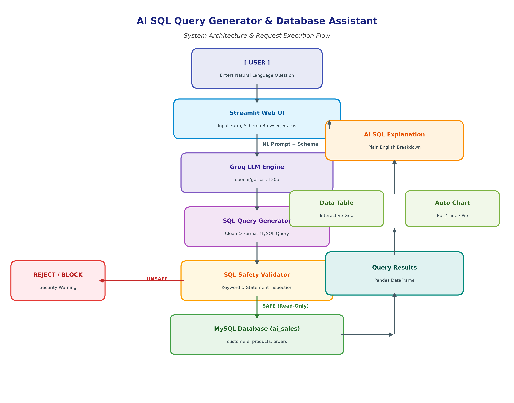

# AI SQL Query Generator & Database Assistant
## 🚀 Live Demo

**Live Application:** [AI SQL Query Generator & Database Assistant](https://aisqlassistant-dvzjpesml8fft94psgt9w8.streamlit.app/)

> The application is deployed on Streamlit Community Cloud and uses Groq for natural-language SQL generation and Aiven MySQL for cloud database execution.

An AI-powered prototype that converts natural-language questions into MySQL SQL queries, validates them for safety, executes them, and presents the results with automatic visualizations and plain-English explanations.

---

## Features

| Feature | Description |
|---|---|
| **Natural Language Input** | Ask questions in plain English about your data |
| **AI SQL Generation** | Groq LLM converts questions into MySQL-compatible SQL |
| **SQL Safety Validation** | Blocks destructive operations (INSERT, UPDATE, DELETE, DROP, etc.) |
| **Query Execution** | Runs safe SQL against a live MySQL database |
| **Result Tables** | Displays query results in clean, scrollable tables |
| **Automatic Charts** | Generates bar, line, pie, or scatter charts based on result structure |
| **SQL Explanations** | Provides plain-English explanations of generated SQL |
| **Error Handling** | Graceful error messages for connection, generation, and execution failures |
| **Schema Browser** | Sidebar showing database tables and columns |
| **Example Queries** | One-click example questions for quick testing |

---

## Architecture

```
User
  │
  ▼
Streamlit UI
  │
  ▼
Natural Language Question
  │
  ▼
Groq LLM (SQL Generator)
  │
  ▼
SQL Validator
  ├── UNSAFE → Reject with explanation
  └── SAFE ──▼
         MySQL Database
              │
              ▼
         Query Results
          ├── Data Table
          └── Chart
              │
              ▼
        SQL Explanation
```



---

## Technology Stack

| Technology | Purpose |
|---|---|
| **Python 3.10+** | Core programming language |
| **Streamlit** | Web application framework |
| **Groq** | LLM API for SQL generation and explanation |
| **MySQL** | Relational database |
| **mysql-connector-python** | MySQL database driver |
| **Pandas** | Data manipulation and DataFrame support |
| **Matplotlib** | Chart generation |
| **python-dotenv** | Environment variable management |

---

## Folder Structure

```
AI_SQL_Assistant/
│
├── app.py                   # Main Streamlit application
├── database.py              # MySQL connection & query execution
├── sql_generator.py         # NL → SQL using Groq LLM
├── sql_validator.py         # SQL safety validation
├── chart_generator.py       # Automatic chart generation
├── sql_explainer.py         # SQL plain-English explanation
├── requirements.txt         # Python dependencies
├── .env.example             # Environment variable template
├── .gitignore               # Git ignore rules
├── README.md                # This file
├── database.sql             # MySQL schema & sample data
│
├── tests/
│   ├── test_sql_validator.py
│   ├── test_sql_generator.py
│   └── test_database.py
│
├── docs/
│   ├── project_report.docx
│   ├── project_report.pdf
│   ├── presentation.pptx
│   ├── architecture.png
│   └── screenshots/
│
└── sample/
    └── sample_queries.txt
```

---

## Prerequisites

- **Python 3.10 or higher**
- **MySQL 8.0+** (running locally or remotely)
- **Groq API Key** (free at [console.groq.com](https://console.groq.com))

---

## MySQL Setup

1. Install MySQL if not already installed.
2. Start the MySQL service.
3. Run the database setup script:

```bash
mysql -u root -p < database.sql
```

This creates the `ai_sales` database with three tables (`customers`, `products`, `orders`) and populates them with realistic sample data.

---

## Environment Variables

1. Copy the example environment file:

```bash
copy .env.example .env
```

2. Edit `.env` and fill in your actual values:

```
GROQ_API_KEY=gsk_your_actual_key_here
GROQ_MODEL=openai/gpt-oss-120b
MYSQL_HOST=localhost
MYSQL_PORT=3306
MYSQL_USER=root
MYSQL_PASSWORD=your_mysql_password
MYSQL_DATABASE=ai_sales
```

> **⚠️ Never commit your `.env` file to version control.**

---

## Installation

### Windows

```powershell
# 1. Open a terminal in the AI_SQL_Assistant directory

# 2. Create a virtual environment
python -m venv .venv

# 3. Activate the virtual environment
.venv\Scripts\activate

# 4. Install dependencies
pip install -r requirements.txt

# 5. Configure environment
copy .env.example .env
# Edit .env with your actual credentials

# 6. Initialize MySQL database
mysql -u root -p < database.sql
```

### macOS / Linux

```bash
python3 -m venv .venv
source .venv/bin/activate
pip install -r requirements.txt
cp .env.example .env
# Edit .env with your credentials
mysql -u root -p < database.sql
```

---

## Running the Application

```bash
streamlit run app.py
```

The application opens in your browser at `http://localhost:8501`.

---

## Example Queries

Try these natural-language questions:

1. Show the top 5 customers by total purchase.
2. What are the top 5 products by sales?
3. Show total sales by city.
4. Which product category generated the highest revenue?
5. Show the total number of orders.
6. Show monthly sales for 2023.
7. List customers from Mumbai.
8. Show products with price above 1000.
9. Show average order amount.
10. Show the customer with the highest total purchase.

---

## Safety Validation

The SQL validator blocks all destructive operations:

| Blocked Operation | Example |
|---|---|
| INSERT | `INSERT INTO customers ...` |
| UPDATE | `UPDATE products SET price = 0` |
| DELETE | `DELETE FROM orders` |
| DROP | `DROP TABLE customers` |
| ALTER | `ALTER TABLE ...` |
| TRUNCATE | `TRUNCATE TABLE ...` |
| Multiple statements | `SELECT 1; DROP TABLE ...` |

Only `SELECT` and `WITH ... SELECT` (CTE) queries are allowed.

---

## Testing

Run all automated tests:

```bash
# From the AI_SQL_Assistant directory
.venv\Scripts\python.exe -m pytest tests/ -v
# Or using unittest:
.venv\Scripts\python.exe -m unittest discover -s tests -v
```

Tests include:
- SQL validator: 30 test cases covering safe and unsafe queries
- SQL generator: 16 test cases covering normalization, formatting, and mocked API responses
- Database module: 11 test cases covering configurations, schema introspection, and mocked connections
- Total: 57 automated unit tests (100% pass rate)

---

## Known Limitations

- **Prototype only** — not designed for production workloads.
- **Single MySQL database** — does not support multiple databases or other RDBMS.
- **No authentication** — no user login or role-based access control.
- **LLM variability** — the AI may occasionally generate slightly incorrect SQL that requires rephrasing.
- **Chart heuristics** — automatic chart selection uses simple rules and may not always choose the optimal chart type.
- **No query history** — previous queries are not persisted between sessions.

---

## Future Improvements

1. **Multi-database support** — PostgreSQL, SQLite, etc.
2. **Query history** — save and replay previous queries.
3. **Enhanced chart selection** — use LLM to recommend chart types.
4. **Authentication** — user login with role-based permissions.
5. **Schema upload** — allow users to upload custom database schemas.
6. **Cloud deployment** — deploy to Streamlit Cloud or GCP.

---

## Troubleshooting

| Issue | Solution |
|---|---|
| MySQL not running | Start MySQL service: `net start mysql` (Windows) |
| Wrong password | Update `MYSQL_PASSWORD` in `.env` |
| Database not found | Run `mysql -u root -p < database.sql` to create it |
| Missing GROQ_API_KEY | Get a free key at [console.groq.com](https://console.groq.com) |
| Import errors | Activate the venv: `.venv\Scripts\activate` |
| Port conflict | Change `MYSQL_PORT` in `.env` or Streamlit port with `--server.port` |

---

## License

Academic project — for educational purposes only.
